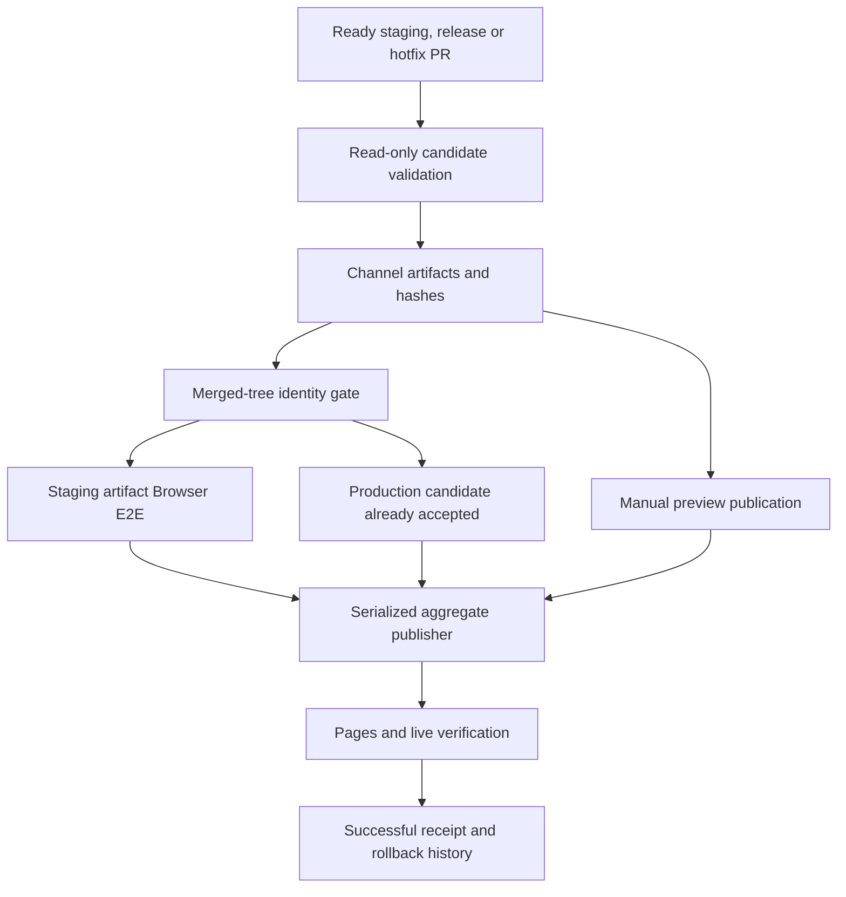

# Deployment architecture

## Workflow enhancements — 13 October 2026

#182 activated delivery and Visual QA on main; #185 promoted the report and capture fixes. #186 is merged into staging, but its removal of periodic integration and metadata-edit jobs still needs main promotion. This checkpoint supersedes older bootstrap/metadata/schedule descriptions below; embedded workflow snapshots remain historical revision evidence. Use the [publishing guide](../deployment/publishing.md) and [Visual QA guide](../deployment/visual-qa.md) for current operation.

- Frontend CI on staging validates source commits and target changes; title/body edits skip all jobs and polling. Ready/draft and qa:visual policies remain intact.
- Integration keeps branch pushes and successful manual main/staging recovery, with completion events filtered to those branches. #186 handles only the event's branch and removes the integration cron; the publisher's recovery schedule remains separate.
- History-only staging sync skips deployment only with matching published receipt, descendant ancestry and exact Git tree. Changed/conflict-resolved content still needs validation. Updating a feature PR still creates a fresh candidate.
- QA executes approved base tooling against the exact candidate; stale head/base/tree identities block evidence. Update the feature branch and validate again rather than rerun an old event.
- Comparison reports offer JSON and Details views, defaulting to Details, for evidence identity/status and test-case outcomes/retries/errors. Captures have passed; owner design and reviewed baseline acceptance remain separate.

## Candidate-to-channel flow

The #130 pipeline separates source validation, browser acceptance and privileged static publication. The operator procedure is [deployment and recovery](../deployment/publishing.md); live evidence belongs in [verification](../deployment/verification.md), issues and milestones.

## Source identity

PR validation uses GitHub's combined merge checkout and records the tree, synthetic candidate SHA, actual PR head/base, CI run, target channel, version and base path. The head must include the current target base. The merge gate compares the actual target-branch tree to the candidate tree: commit SHA differences from merge/squash are tolerated only for identical content. Old/expired artifacts, wrong PR/channel/base, forks, failed CI and changed trees stop promotion.

Release/hotfix ready PRs include sharded production-candidate Browser E2E in Frontend CI. Candidate validation is the stable required check. Staging PRs omit browsers until integration; the staging merge tests its downloaded artifact before publication. Reusable browser jobs retain Chromium/Firefox/WebKit, native-focus/Xvfb and compact failure evidence. No browser job rebuilds a different candidate.

## Artifacts

candidate-build bundles channel folders, not one path-agnostic build. schema-2 build.json includes SHA-256 file hashes and source/channel identities. Verification covers every file and rejects symlinks, unexpected additions/changed bytes and reserved managed paths. Preview and deployment base paths are compiled independently; production artifact bytes are reused after verified merge.

The artifact uploader's digest is additional transport evidence; application verification enforces content hashes and source identity as hard errors. A self-contained manifest is not an independent signing authority: source PR reviews, repository provenance, successful CI and branch/environment controls remain part of trust.

## Privilege boundary

PR builds/browser jobs are read-only. Publication checks out only reviewed main or staging orchestration, downloads static artifact content and never executes artifact scripts. pull_request_target is used only for PR-state reconciliation with trusted checkout; PR code is not checked out or executed by that privileged handler. Same-repository preview eligibility is enforced again before copying. workflow_run recovery only accepts successful manually dispatched Frontend CI on current main/staging and cannot turn a fork PR artifact into a production build.

main/staging protections and github-pages allowed branches/reviewers are owner configuration. Shared-origin storage namespacing is data separation, not an origin security boundary. Do not publish private documents, fixture content or credentials.

## Aggregate and recovery state

pages-state is generated deployment state, not a development branch. It contains production at root, staging/, preview/pr-N/, desired .deployment-state.json, public deployment.json, acknowledged .publication-receipt.json and .deployment-history.json. Production replacements preserve staging/previews/managed history; staging replacements preserve production/previews. channel.json supplies current staging alignment and preview draft notices.

The pages-publisher concurrency group uses queue:max/cancel-in-progress:false. Fresh branch/PR checks and per-channel run guards protect against non-FIFO completion and delayed events. Main and staging planning are independent. Save desired content first, deploy and verify live identities/assets, then acknowledge the aggregate. Failed deployment or live checks leave a mismatched receipt for retry. Closed preview cleanup is independent of application acceptance; schedules cover missed events.

Integration recovery reselects a current validated merged candidate, with staging browser acceptance before promotion. Receipt recovery republishes already selected aggregate bytes without rebuilding. Neither bypasses failed frontend checks, artifact expiration or content mismatch. Documentation-only descendants of a published source do not generate a new deployment.

## Retained rollback

Approved channel artifacts are retained under .deployment-archives/<channel>/<tree>-<run>. Archive payloads are excluded from the uploaded Pages site. Only successful live acknowledgments enter deployment history. Manual rollback selects an existing published history entry, verifies the archive and restores that channel. A rollback hold records the current branch revision separately from historical artifact/source identity; automatic integration waits for source reconciliation or an explicitly validated manual recovery.

Archive retention/repository growth and immutable versioned public URLs remain #32 acceptance. Tags do not publish the website. Reverted source and hotfix/release synchronization use reviewed PRs; there is no silent branch merge.

## Browser data migration

Production keeps its existing PDF/EPUB/annotations/workspace IndexedDB names. Staging appends :staging; numbered previews append :preview-N. All persisted file handles and reading metadata use the channel database helper. Theme preference remains shared. Hash routes use the compiled channel base path.

## Activation and acceptance

The first implementation merges to staging and is then released to main. Scheduled/default-branch manual/recovery/cleanup behavior changes only when installed on main; avoid the legacy main manual publisher during bootstrap because it cannot preserve staging. Local/PR checks cannot establish production live acceptance. #130 and #44 remain open until owner settings, actual staging/release/hotfix routing, cleanup, failed-publication recovery and rollback are verified. Historical run records remain evidence for their original revisions, not acceptance for this pipeline.

[Operator guide](../deployment/publishing.md) · [Documentation home](../README.md)

## Design QA evidence

[Design QA and reviewed visual baselines](../deployment/visual-qa.md) documents manual current-candidate capture, owner source comparison, separate statuses and regression integration. Full Browser E2E triggers and publication policy remain unchanged.
