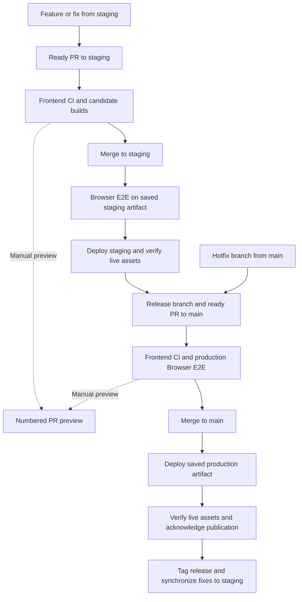

# PaperTrail deployment — practical guide and workflow walkthrough

> Implementation reference: PR #170 / issue #130, workflow source commit `80349c1a7310413f263a96a152c443ee18812705`.
> Prepared 12 October 2026. CI and merge-tracking snapshots include the subsequent fixes in PR #170; merge-tracking below reflects the staging-reconciliation revision in PR #170. These workflows are proposed on `feat/130-staging-delivery`; this guide does not claim main activation, live staging acceptance or owner settings are complete.
> This is a standalone reading guide. Existing deployment documents remain unchanged. Planning remains in GitHub Wiki and milestones.

## How to read this guide

Start with the flowchart and operating steps. The complete YAML and explanations are in the final reference section. You do not need to read the workflow code to publish a preview or prepare a release.

## Contents

- [Complete deployment flow](#complete-deployment-flow)
- [Branches and website addresses](#branches-and-website-addresses)
- [One-time setup and initial activation](#one-time-setup-and-initial-activation)
- [Feature and bug-fix delivery](#feature-and-bug-fix-delivery)
- [Manual PR previews](#manual-pr-previews)
- [Release and production delivery](#release-and-production-delivery)
- [Production hotfixes](#production-hotfixes)
- [Failed checks, deployments and recovery](#failed-checks-deployments-and-recovery)
- [Rollback](#rollback)
- [PR lifecycle and other edge cases](#pr-lifecycle-and-other-edge-cases)
- [Validation, identity and saved data](#validation-identity-and-saved-data)
- [Operator checklist](#operator-checklist)
- [Complete workflow files and explanations](#complete-workflow-files-and-explanations)

## Complete deployment flow

The solid path is normal delivery. The dotted paths are optional manual previews. A failed check stops its path: the last deployed environment remains until an accepted publication succeeds.



Hotfix PRs use `hotfix/*`; release PRs use `release/<version>`. Both target main and pass production-candidate checks. Preview publication does not merge source or update a stable environment.

The diagram groups multiple jobs for readability. Browser testing happens before staging publication and before main merge. Small live checks happen after publication. Full frontend CI is not repeated on a normal merge when the merged contents match the accepted candidate.

## Branches and website addresses

| Purpose              | Create from                   | PR target          | Website                                                 |
| -------------------- | ----------------------------- | ------------------ | ------------------------------------------------------- |
| Feature / fix branch | Updated staging               | staging            | Optional numbered preview                               |
| staging              | Initially main                | Integration branch | https://himanshuhd.github.io/papertrail-reader/staging/ |
| release/X.Y.Z        | Accepted staging revision     | main               | Optional numbered preview                               |
| hotfix/description   | Updated main                  | main               | Optional numbered preview                               |
| main                 | Accepted release / hotfix PRs | Production branch  | https://himanshuhd.github.io/papertrail-reader/         |

Numbered preview: `https://himanshuhd.github.io/papertrail-reader/preview/pr-N/`.

These are default paths. The `PAGES_BASE_PATH` repository variable can change the base; it must be an absolute path with a trailing slash. A custom-domain root can use `/`.

Create one implementation branch at a time. After its merge, create the next branch from updated staging. Do not prepare a batch of future branches with stale bases.

## One-time setup and initial activation

### Owner configuration

1. GitHub Settings → Pages: retain **GitHub Actions** as the deployment source.
2. Protect main and staging: require PRs, require **Candidate validation**, require the branch to be up to date, block direct/force pushes and deletion, and restrict bypasses.
3. Choose an appropriate reviewer count. A sole maintainer must avoid a rule requiring an unavailable second reviewer.
4. Configure the `github-pages` environment to permit deployments from main and staging.
5. Decide its approval policy. All channels share the environment, so required environment approval also affects previews, cleanup and recovery.
6. Retain candidate and browser artifacts for at least the workflow's 30-day setting. Expired candidates require fresh acceptance.
7. Do not enable merge queue for this implementation: a `merge_group` validation trigger is not included.

These administrative settings are owner actions; a code change cannot claim they have been applied.

### First activation of #130

1. Review PR #170 and its Candidate validation.
2. Merge it to staging.
3. Its staging integration runs Browser E2E, then publishes staging and verifies the live build.
4. Record actual staging acceptance. A successful frontend PR run alone does not complete #130.
5. Prepare a reviewed release branch from staging, update package.json/package-lock.json consistently and target main.
6. Complete release CI/browser acceptance and merge to main.
7. The new default-branch schedules, workflow-run recovery, manual forms and cleanup handlers are then active.

During bootstrap, previews can invoke the new publisher from staging with the staging target. Avoid manually dispatching the legacy main publisher: it does not preserve the new staging channel. If a manual-CI recovery completes before the new default-branch handler exists, resume integration after activation.

## Feature and bug-fix delivery

### Before merge

1. Update staging and create `feature/<description>` or `fix/<description>`.
2. Implement the issue and open a **draft PR targeting staging**.
3. Draft PRs do not run application CI and cannot request a new preview.
4. Mark the PR ready when it is reviewable.
5. Frontend CI installs locked dependencies, runs lint, formatting, unit/pipeline tests and type checks, then builds preview and staging candidates.
6. Wait for **Candidate validation** to pass.
7. Optionally publish a preview and compare it with stable staging.
8. Merge only the current accepted revision.

New commits to a ready PR run CI again and supersede older acceptance. If staging advanced, update the branch from staging and obtain fresh acceptance.

### After merge

1. Integrate and promote finds the successful PR candidate.
2. It checks the actual merged content tree against that candidate and verifies checksums.
3. It tests the exact saved staging build with Browser E2E.
4. On success, it publishes staging while preserving production and other previews.
5. It verifies live identities and critical assets, then records acknowledgment.
6. Closed-preview cleanup replaces that PR preview with the retired page.

No repeated frontend build is needed for an identical merged tree. If the merged contents differ, automatic reuse is rejected; use the documented recovery path.

## Manual PR previews

Previews are always an explicit request. PR CI does not publish them automatically.

1. Wait for the current ready PR's Candidate validation to pass.
2. Actions → **Publish website** → **Run workflow**.
3. After activation, normally select main as the workflow source.
4. Select target environment `staging` for a staging PR, or `main` for a release/hotfix PR.
5. Select operation `preview` and enter the PR number.
6. Inspect the job summary and numbered preview.
7. Confirm its footer/source identity, then compare with the appropriate stable environment.

Eligible PRs are open, ready and from this repository:

- any accepted staging-targeted feature/fix PR;
- a `release/*` or `hotfix/*` PR targeting main.

Drafts, forks, closed PRs, old heads and arbitrary feature PRs targeting main are rejected. A new commit does not silently refresh an existing preview. Publish it again after new checks pass.

## Release and production delivery

### Prepare and validate

1. Select an accepted staging revision. Do not release a revision whose staging integration is still failing.
2. Create `release/X.Y.Z` or `release/vX.Y.Z`.
3. Update package.json and package-lock.json to that version; the release branch name must match package.json.
4. Maintain reviewed release notes/changelog.
5. Open a draft PR to main; mark ready when prepared.
6. Frontend CI builds production and preview artifacts.
7. Production Browser E2E tests the exact saved production-path artifact.
8. Wait for Candidate validation, including both browser shards.
9. Optionally publish a release preview.

A release branch freezes the selected revision. Staging may continue progressing. Compare the release preview with the chosen release revision rather than assuming it must equal a newer staging deployment.

### Merge, promote and release

1. Update the release branch from current main before final validation, especially if a hotfix landed.
2. Merge the final accepted release PR.
3. Promotion verifies the merged content tree and accepted candidate, then deploys the saved production artifact.
4. It preserves staging and previews.
5. Live identity and critical-asset checks must pass before acknowledgment.
6. Create the SemVer tag against the exact released main revision and publish the GitHub Release with reviewed notes.
7. Synchronize release fixes and metadata into staging through a reviewed PR.

Tags do not trigger website deployment here. Automated tags/GitHub Releases, immutable versioned website URLs and full release-artifact retention remain separate #32 work.

Staging stays usable after production release. Its footer reports alignment when staging and production content trees match; otherwise it reports unreleased changes. It is not replaced by a fallback page.

## Production hotfixes

1. Create `hotfix/<description>` from current main, not staging.
2. Apply the smallest suitable fix; update patch version/notes where appropriate.
3. Open a PR to main and mark ready.
4. Pass frontend CI and production-candidate Browser E2E.
5. Optionally publish a hotfix preview.
6. Merge and verify production promotion.
7. Tag/publish the patch release against the verified main revision.
8. Synchronize the fix into staging and every active release branch using reviewed PRs.
9. Resolve conflicts and repeat acceptance for changed candidates.

Synchronization is manual reviewed source work. The workflow never silently merges branches. Any emergency bypass is an explicit owner decision with a recorded reason and follow-up validation.

## Failed checks, deployments and recovery

| Failure                                   | Effect                                                     | Next action                                                              |
| ----------------------------------------- | ---------------------------------------------------------- | ------------------------------------------------------------------------ |
| Frontend CI fails                         | Candidate is not accepted                                  | Fix the PR and rerun current-head validation                             |
| Release/hotfix Browser E2E fails          | Main candidate cannot pass the gate                        | Fix/revalidate the PR; rerun transient failures only when appropriate    |
| Staging integration E2E fails             | New staging build is not published                         | Fix via another staging PR or rerun a transient failed job               |
| Candidate expired or missing              | Promotion stops                                            | Manually validate current main/staging                                   |
| Merged tree differs from candidate        | Candidate reuse rejected                                   | Manually validate actual branch contents                                 |
| Branch advances while publishing          | Obsolete promotion stops                                   | Let the current candidate proceed; revalidate if required                |
| Pages deployment fails                    | Desired state can exist without a successful receipt       | Fix the failure, then reconcile saved state                              |
| Live identity/asset check fails           | Deployment is not acknowledged; live site may have changed | Inspect the actual live result, repair/reconcile or explicitly roll back |
| Queued job cancelled or event missed      | Publication may remain pending                             | Scheduled reconciliation retries; inspect its outcome                    |
| Already acknowledged, no cleanup required | Successful no-op                                           | No deployment required                                                   |

A saved deployment state is not proof that the live site is correct. A successful Pages action without live verification is also not accepted delivery. Recovery is not an automatic guarantee that every external failure resolves without intervention.

### Recover a missing or unusable candidate

1. Actions → **Frontend CI** → Run workflow.
2. Select exactly current `main` or `staging`.
3. This validates/builds that branch. Main also runs production Browser E2E.
4. After success, the workflow-run handler resumes integration.
5. Staging still runs integration Browser E2E before publication.

This intentionally repeats acceptance when an accepted reusable candidate is unavailable. Do not dispatch an arbitrary feature branch to bypass PR acceptance.

### Recover saved-but-unacknowledged publication

1. Actions → **Publish website** → Run workflow.
2. Select operation `reconcile`.
3. The workflow republishes saved aggregate state and cleans closed previews.
4. Inspect live verification and the successful receipt.

Reconcile does not build new source or accept an unvalidated candidate. A blank PR number is not a production promotion command.

Two scheduled processes serve different purposes:

- **Integrate and promote**, minute 23/53: selects accepted source that still needs promotion.
- **Publish website**, minute 17/47: recovers saved publication state and preview cleanup.

Cron times are UTC; GitHub schedules are best effort. Shared publication is serialized with a bounded pending queue.

## Rollback

Rollback changes the deployed channel, not the source branch.

1. Identify a previously successful channel archive in deployment history. Its ID is `<40-character-tree-SHA>-<run-ID>`.
2. Actions → Publish website → Run workflow.
3. Select target `main` or `staging`.
4. Select operation `rollback` and enter the archive ID.
5. The publisher checks that it was a successful publication, verifies the retained archive and preserves other channels.
6. It deploys and verifies the restored site.
7. Record the incident and follow-up source fix/revert.

A hold records the current source head so scheduled promotion does not immediately redeploy that same revision over the rollback. A newer accepted revision can resume normal promotion. Rollback archives are retained in pages-state and excluded from public Pages files.

This is known-published channel rollback, not an immutable versioned-release hosting system. Long-term archive growth and release retention policy remain #32 acceptance.

## PR lifecycle and other edge cases

| Event or condition                   | Behavior                                                                                          |
| ------------------------------------ | ------------------------------------------------------------------------------------------------- |
| Open draft PR                        | Application validation skipped; no new preview                                                    |
| Mark ready                           | Current candidate validation starts                                                               |
| Push to ready PR                     | New validation; old validation superseded                                                         |
| Edit title/body/checklist            | Reuse and verify an accepted artifact; no repeated application tests                              |
| Change PR target                     | New validation for the target channel                                                             |
| Return to draft                      | Cancel obsolete PR validation; disable new preview requests; update existing preview draft notice |
| Close or merge PR                    | Retire its published preview                                                                      |
| Reopen PR                            | Ready validation can run; an old retired preview requires a fresh manual publication              |
| Fork PR                              | No privileged preview publication                                                                 |
| Feature PR targets main              | Delivery policy rejects it; use staging                                                           |
| Direct push / missing accepted PR    | Normal automatic reuse cannot establish acceptance; use explicit current-branch recovery          |
| Docs-only revision                   | Still validated; publication/browser may be skipped when no website change is required            |
| Main and staging events overlap      | Channel selection is independent; actual Pages publishing is serialized                           |
| Artifact/source changed              | Identity/checksum verification rejects mismatches                                                 |
| New production hotfix during release | Update active release and staging; revalidate current candidates                                  |
| Merge queue requested                | Unsupported until merge_group validation is implemented                                           |

## Validation, identity and saved data

### Why build separate preview and destination artifacts?

A preview runs under `/preview/pr-N/`; staging runs under `/staging/`; production runs at the repository base. Vite compiles asset paths into the build. The same bytes cannot simply be moved between these paths. CI builds each needed channel once and later promotes its matching artifact.

### Why compare a tree as well as a commit SHA?

A squash or merge can create a new commit SHA. Reuse is safe only when its file-content tree equals the accepted candidate tree. SHA changes alone are allowed; content changes are not.

### What identity is retained?

The build manifest records schema, source/candidate identities, PR head/base, tree, channel, run ID, URL base, version and SHA-256 file checksums. Promotion validates these instead of selecting “whatever artifact was uploaded last.”

### What is pages-state?

It is a bot-managed branch containing the aggregate desired website, channel metadata, successful receipt/history and retained rollback archives. It is deployment state, not an implementation branch. Publication preserves unrelated channels.

### What happens to reading data?

Production database names remain unchanged. Staging and numbered previews use separate namespaces for reading metadata, annotations and saved file-access handles. A staging verification should not overwrite production reading data. PDF/EPUB document contents are not copied into these stores by the deployment feature.

### What evidence is retained?

Candidate and promotion artifacts plus browser reports/traces/screenshots are retained for 30 days. Browser evidence includes candidate/browser identities and run attempts. Publication history contains acknowledged live deployments. CI passing does not substitute for pending live recovery, rollback and storage-isolation acceptance.

## Operator checklist

### Before routine operation

- [ ] Owner branch protection and environment settings configured.
- [ ] Initial staging integration/browser/deployment accepted.
- [ ] New workflow set activated on main.
- [ ] Live cleanup, recovery, rollback and storage isolation recorded under #130/#44.

### Feature merge

- [ ] PR targets staging and is current with its base.
- [ ] Current Candidate validation passes.
- [ ] Preview inspected when needed.
- [ ] Post-merge staging Browser E2E and live publication checked.

### Production release

- [ ] Accepted staging revision selected.
- [ ] Version, branch name and reviewed notes consistent.
- [ ] Release/hotfix PR contains current main.
- [ ] Current frontend and production browser acceptance pass.
- [ ] Production live identity/assets and receipt verified.
- [ ] Tag/release references exact released main revision.
- [ ] Release/hotfix fixes synchronized to staging and active release branches.
- [ ] Issues, PR checklists and milestone acceptance reconciled without marking unverified checks complete.

## Complete workflow files and explanations

CI and merge-tracking show the updated PR implementation; the other four workflow files use the reference commit. It is included for learning and review; edit the actual files under `.github/workflows/` when changing behavior. Future workflow changes should refresh this snapshot and reference.

### GitHub Actions vocabulary

| Syntax / term        | Meaning                                                                   |
| -------------------- | ------------------------------------------------------------------------- |
| `on`                 | Events that start a workflow                                              |
| `jobs`               | Independent units executed on runners                                     |
| `steps`              | Ordered actions/commands within a job                                     |
| `needs`              | Jobs that must finish first                                               |
| `if`                 | Condition deciding whether the job/step runs                              |
| `outputs`            | Values passed to later jobs                                               |
| `env`                | Environment variables exposed to a step/process                           |
| `workflow_call`      | Reusable workflow called by another workflow                              |
| `workflow_dispatch`  | Manual Run workflow action                                                |
| `matrix`             | Execute the job for several input combinations                            |
| `always()`           | Evaluate even when dependencies failed; other conditions still apply      |
| `success()`          | Continue only after preceding steps succeeded                             |
| `${{ ... }}`         | GitHub Actions expression                                                 |
| Action commit SHA    | Pins the action implementation rather than following a moving version tag |
| Candidate / artifact | Built app awaiting deployment / saved workflow files                      |
| Receipt              | Record written after deployment and live verification succeed             |

### ci.yml — Frontend CI

[Source file](https://github.com/HimanshuHD/papertrail-reader/blob/80349c1a7310413f263a96a152c443ee18812705/.github/workflows/ci.yml)

```yaml
name: Frontend CI
on:
  pull_request:
    branches: [main, staging]
    types: [opened, ready_for_review, synchronize, reopened, converted_to_draft, edited]
  workflow_dispatch:
permissions:
  contents: read
  actions: read
  pull-requests: read
concurrency:
  group: frontend-ci-${{ github.event.action == 'edited' && github.event.changes.base == null && format('metadata-{0}', github.run_id) || github.event.pull_request.number || github.ref }}
  cancel-in-progress: true
jobs:
  frontend:
    name: Validate and build website
    if: github.event_name == 'workflow_dispatch' || ((github.event.pull_request.state == 'open' && github.event.pull_request.draft == false) && (github.event.action != 'edited' || github.event.changes.base != null))
    outputs:
      website: ${{ steps.build.outputs.publish }}
    runs-on: ubuntu-latest
    timeout-minutes: 15
    steps:
      - uses: actions/checkout@11d5960a326750d5838078e36cf38b85af677262 # v4
        with:
          persist-credentials: false
          fetch-depth: 0
      - uses: actions/setup-node@49933ea5288caeca8642d1e84afbd3f7d6820020 # v4
        with:
          node-version: '24'
          cache: npm
      - run: npm ci --no-audit --no-fund
      - run: npm run lint
      - run: npm run format:check
      - run: npm test
      - run: npm run type-check
      - name: Build channel-specific candidates
        id: build
        env:
          TARGET_BRANCH: ${{ github.event.pull_request.base.ref || github.ref_name }}
          HEAD_SHA: ${{ github.event.pull_request.head.sha || github.sha }}
          BASE_SHA: ${{ github.event.pull_request.base.sha }}
          SOURCE_BRANCH: ${{ github.head_ref || github.ref_name }}
          PR_NUMBER: ${{ github.event.pull_request.number }}
          BASE_PATH: ${{ vars.PAGES_BASE_PATH || '/papertrail-reader/' }}
        run: node scripts/build-candidates.mjs
      - uses: actions/upload-artifact@ea165f8d65b6e75b540449e92b4886f43607fa02 # v4
        with:
          name: candidate-build
          path: candidate/
          retention-days: 30
          overwrite: true
  browser:
    needs: frontend
    if: needs.frontend.outputs.website == 'true' && ((github.event.pull_request.base.ref == 'main' && (github.event.pull_request.state == 'open' && github.event.pull_request.draft == false)) || (github.event_name == 'workflow_dispatch' && github.ref == 'refs/heads/main'))
    uses: ./.github/workflows/browser-e2e.yml
    with:
      build_run: ${{ format('{0}', github.run_id) }}
      channel: production
      source_ref: ${{ github.sha }}
      source_sha: ${{ github.event.pull_request.head.sha || github.sha }}
  gate:
    name: Candidate validation
    timeout-minutes: 20
    if: always() && (github.event_name == 'workflow_dispatch' || (github.event.pull_request.state == 'open' && github.event.pull_request.draft == false))
    needs: [frontend, browser]
    runs-on: ubuntu-latest
    steps:
      - uses: actions/checkout@11d5960a326750d5838078e36cf38b85af677262 # v4
        if: github.event.action == 'edited' && github.event.changes.base == null
        with:
          persist-credentials: false
      - name: Reuse accepted candidate for a metadata-only edit
        id: previous
        if: github.event.action == 'edited' && github.event.changes.base == null
        uses: actions/github-script@f28e40c7f34bde8b3046d885e986cb6290c5673b # v7
        with:
          script: |
            const {waitForCandidate,branchChannel}=await import(require('node:url').pathToFileURL(process.cwd()+'/scripts/delivery-policy.mjs').href);
            const pr=context.payload.pull_request;
            const p=await waitForCandidate({github,...context.repo,branch:pr.base.ref,prNumber:pr.number,expectedHead:pr.head.sha,expectedBase:pr.base.sha},{onWait:attempt=>core.info('Waiting for current full CI acceptance; poll '+attempt)});
            p.channel=branchChannel(pr.base.ref);
            require('node:fs').writeFileSync('promotion-plan.json',JSON.stringify(p));
            core.setOutput('run_id',p.runId);
      - uses: actions/download-artifact@d3f86a106a0bac45b974a628896c90dbdf5c8093 # v4
        if: github.event.action == 'edited' && github.event.changes.base == null
        with:
          name: candidate-build
          path: incoming
          github-token: ${{ github.token }}
          run-id: ${{ steps.previous.outputs.run_id }}
      - name: Verify target artifact without repeating application tests
        if: github.event.action == 'edited' && github.event.changes.base == null
        env:
          BASE_PATH: ${{ vars.PAGES_BASE_PATH || '/papertrail-reader/' }}
        run: node scripts/verify-delivery.mjs
      - if: github.event.action != 'edited' || github.event.changes.base != null
        env:
          FRONTEND: ${{ needs.frontend.result }}
          BROWSER: ${{ needs.browser.result }}
          TARGET: ${{ github.event.pull_request.base.ref || github.ref_name }}
          WEBSITE: ${{ needs.frontend.outputs.website }}
        run: |
          test "$FRONTEND" = success
          if [ "$TARGET" = main ] && [ "$WEBSITE" = true ]; then test "$BROWSER" = success; fi
```

#### Block-by-block explanation

1. **Triggers.** PRs target main/staging. opened, ready_for_review, synchronize (new commits), reopened, converted_to_draft and edited are observed. workflow_dispatch provides current-branch recovery.

2. **Read permissions.** The workflow reads source, PRs and artifacts. It cannot publish the website or write source.

3. **Concurrency.** New validation cancels older validation for the same PR/ref. Metadata-only edits use a unique run group so a checklist edit cannot cancel active application validation.

4. **Frontend condition and outputs.** Manual validation or a ready PR runs frontend checks. Drafts and title/body-only edits skip repeated application checks. Changing the target base reruns them. website exposes whether publication is required.

5. **Checkout and Node.** Checks out the combined PR merge source, uses read-only credentials and complete history, then Node 24 with npm cache. npm ci installs package-lock dependencies; the cache is not a browser-engine cache.

6. **Checks.** Lint, formatting, unit/component and pipeline tests, and strict type checks must pass.

7. **Build candidate environment.** TARGET_BRANCH chooses staging/production; HEAD_SHA, BASE_SHA, SOURCE_BRANCH and PR_NUMBER retain provenance. BASE_PATH chooses compiled URL paths. build-candidates.mjs validates branch/version/base rules and builds separate preview/destination candidates.

8. **Upload.** candidate-build saves candidate/ for 30 days. overwrite permits a rerun to replace that run's artifact. No publication occurs.

9. **Browser job.** Runs production-path acceptance for website-affecting ready main PRs or manual main recovery. Supporting policy restricts main PRs to release/hotfix candidates. Staging PRs wait until post-merge integration for full E2E.

10. **Required gate.** Candidate validation runs even when dependencies fail. Normal validation requires frontend success, plus browser success for main website changes. Metadata-only edits select a previously successful eligible run, download its artifact and verify the target channel rather than merely accepting a skipped job.

### delivery.yml — Integration entry point

[Source file](https://github.com/HimanshuHD/papertrail-reader/blob/80349c1a7310413f263a96a152c443ee18812705/.github/workflows/delivery.yml)

```yaml
name: Integrate and promote
on:
  push:
    branches: [main, staging]
  schedule:
    - cron: '23,53 * * * *'
  workflow_run:
    workflows: [Frontend CI]
    types: [completed]
permissions:
  contents: read
  actions: read
jobs:
  channel:
    if: github.event_name != 'workflow_run' || (github.event.workflow_run.event == 'workflow_dispatch' && github.event.workflow_run.conclusion == 'success')
    strategy:
      fail-fast: false
      matrix:
        branch: [main, staging]
    permissions:
      actions: read
      contents: write
      pull-requests: read
      pages: write
      id-token: write
    uses: ./.github/workflows/channel-delivery.yml
    with:
      branch: ${{ matrix.branch }}
```

#### Block-by-block explanation

1. **Triggers.** Pushes to main/staging start integration. Minute 23/53 UTC schedules recover missed promotion. Frontend CI completion is also observed.

2. **workflow_run filter.** Only successful manually dispatched frontend validation triggers this recovery path. Ordinary PR CI cannot automatically publish a preview.

3. **Channel matrix.** main and staging are evaluated independently. fail-fast:false prevents one failure cancelling the other. The called workflow skips unrelated branch events.

4. **Permissions and delegation.** Nested publication needs actions/PR read, contents write, Pages write and id-token write. The job calls channel-delivery.yml with the selected branch; it does not rerun frontend CI.

### channel-delivery.yml — Select and promote a channel

[Source file](https://github.com/HimanshuHD/papertrail-reader/blob/80349c1a7310413f263a96a152c443ee18812705/.github/workflows/channel-delivery.yml)

```yaml
name: Validate promotion channel
on:
  workflow_call:
    inputs:
      branch:
        required: true
        type: string
permissions:
  contents: read
  actions: read
  pull-requests: read
jobs:
  select:
    runs-on: ubuntu-latest
    outputs:
      skip: ${{ steps.plan.outputs.skip == 'true' || steps.verify.outputs.publish == 'false' }}
      run_id: ${{ steps.plan.outputs.run_id }}
      sha: ${{ steps.plan.outputs.sha }}
      source_ref: ${{ steps.plan.outputs.source_ref }}
    steps:
      - uses: actions/checkout@11d5960a326750d5838078e36cf38b85af677262 # v4
        with:
          ref: ${{ inputs.branch }}
          persist-credentials: false
      - name: Select validated candidate for this channel
        id: plan
        uses: actions/github-script@f28e40c7f34bde8b3046d885e986cb6290c5673b # v7
        env:
          BRANCH: ${{ inputs.branch }}
        with:
          script: |
            const branch=process.env.BRANCH;
            if(!['main','staging'].includes(branch)) throw Error('Unsupported channel');
            if(context.eventName==='push' && context.ref!=='refs/heads/'+branch) { core.setOutput('skip','true'); return; }
            if(context.eventName==='workflow_run' && context.payload.workflow_run.head_branch!==branch) { core.setOutput('skip','true'); return; }
            const {selectCandidate}=await import(require('node:url').pathToFileURL(process.cwd()+'/scripts/delivery-policy.mjs').href);
            const plan=await selectCandidate({github,...context.repo,branch,sourceSha:context.eventName==='push'?context.sha:undefined,manualRun:context.eventName==='workflow_run'?context.payload.workflow_run.id:undefined});
            if(plan.skip) { core.setOutput('skip','true'); core.summary.addRaw(plan.reason).write(); return; }
            if(context.eventName==='workflow_run') plan.manualRun=String(context.payload.workflow_run.id);
            require('node:fs').writeFileSync('promotion-plan.json',JSON.stringify(plan));
            core.setOutput('run_id',plan.runId);
            core.setOutput('sha',plan.headSha);
            core.setOutput('source_ref',plan.sourceSha);
      - uses: actions/download-artifact@d3f86a106a0bac45b974a628896c90dbdf5c8093 # v4
        if: steps.plan.outputs.skip != 'true'
        with:
          name: candidate-build
          path: incoming
          github-token: ${{ github.token }}
          run-id: ${{ steps.plan.outputs.run_id }}
      - name: Verify merged content and candidate checksums
        id: verify
        if: steps.plan.outputs.skip != 'true'
        env:
          BASE_PATH: ${{ vars.PAGES_BASE_PATH || '/papertrail-reader/' }}
        run: node scripts/verify-delivery.mjs
      - uses: actions/upload-artifact@ea165f8d65b6e75b540449e92b4886f43607fa02 # v4
        if: steps.plan.outputs.skip != 'true' && steps.verify.outputs.publish == 'true'
        with:
          name: promotion-${{ inputs.branch }}
          path: |
            promotion-plan.json
            verified-build.json
          retention-days: 30
          overwrite: true
  browser:
    needs: select
    if: inputs.branch == 'staging' && needs.select.outputs.skip != 'true'
    uses: ./.github/workflows/browser-e2e.yml
    with:
      build_run: ${{ needs.select.outputs.run_id }}
      channel: staging
      source_sha: ${{ needs.select.outputs.sha }}
      source_ref: ${{ needs.select.outputs.source_ref }}
  publish:
    needs: [select, browser]
    if: always() && needs.select.result == 'success' && needs.select.outputs.skip != 'true' && (inputs.branch == 'main' || needs.browser.result == 'success')
    permissions:
      actions: read
      contents: write
      pull-requests: read
      pages: write
      id-token: write
    uses: ./.github/workflows/pages.yml
    with:
      branch: ${{ inputs.branch }}
      promotion_run: ${{ format('{0}', github.run_id) }}
```

#### Block-by-block explanation

1. **Reusable input.** workflow_call accepts the destination branch. This is not a standalone manually dispatched workflow.

2. **Selection and outputs.** Checkout is the trusted integration branch. The script rejects unsupported channels, skips unrelated events, and calls selectCandidate. Outputs identify skip state, candidate run/head and actual source revision.

3. **Promotion plan.** The selected accepted current candidate is recorded in promotion-plan.json. Stale/acknowledged/held revisions can skip with a reason. Manual recovery run identity is retained.

4. **Download and verify.** Downloads the original candidate-build and verifies actual merged tree, source/channel/base identities and checksums. No application rebuild. Website-unaffected changes can set publish:false.

5. **Promotion handoff.** Stores promotion-branch containing the plan and verified manifest for 30 days. This handoff is from the same integration run.

6. **Staging browser.** Only staging calls Browser E2E here. It tests the saved staging build against matching source. Failure blocks new staging publication.

7. **Publisher.** Requires successful selection and, for staging, successful E2E. main reuses earlier release/hotfix acceptance. The current integration run ID authorizes the handoff to pages.yml.

### browser-e2e.yml — Test the exact saved build

[Source file](https://github.com/HimanshuHD/papertrail-reader/blob/80349c1a7310413f263a96a152c443ee18812705/.github/workflows/browser-e2e.yml)

```yaml
name: Browser E2E

on:
  workflow_call:
    inputs:
      build_run:
        required: true
        type: string
      channel:
        required: true
        type: string
      source_sha:
        required: true
        type: string
      source_ref:
        required: false
        type: string
permissions:
  contents: read
  actions: read

concurrency:
  group: browser-e2e-${{ inputs.channel }}-${{ github.event.pull_request.number || github.ref }}
  cancel-in-progress: true

jobs:
  browser:
    name: Explicit browser acceptance (shard ${{ matrix.shard }}/2)
    strategy:
      fail-fast: false
      matrix:
        shard: [1, 2]
    runs-on: ubuntu-latest
    timeout-minutes: 20
    env:
      E2E_SOURCE_SHA: ${{ inputs.source_sha }}
      E2E_SHARD: ${{ matrix.shard }}/2
      E2E_BASE_PATH: ${{ inputs.channel == 'staging' && format('{0}staging/', vars.PAGES_BASE_PATH || '/papertrail-reader/') || vars.PAGES_BASE_PATH || '/papertrail-reader/' }}
    steps:
      - uses: actions/checkout@11d5960a326750d5838078e36cf38b85af677262 # v4
        with:
          persist-credentials: false
          ref: ${{ inputs.source_ref || github.sha }}
      - uses: actions/setup-node@49933ea5288caeca8642d1e84afbd3f7d6820020 # v4
        with:
          node-version: '24'
          cache: npm
      - run: npm ci --no-audit --no-fund
      - uses: actions/download-artifact@d3f86a106a0bac45b974a628896c90dbdf5c8093 # v4
        with:
          name: candidate-build
          path: incoming
          github-token: ${{ github.token }}
          run-id: ${{ inputs.build_run }}
      - name: Verify and serve the exact candidate artifact
        env:
          CHANNEL: ${{ inputs.channel }}
          BUILD_RUN: ${{ inputs.build_run }}
          SOURCE_SHA: ${{ inputs.source_sha }}
        run: |
          node --input-type=module -e "import fs from 'node:fs'; import {execFileSync} from 'node:child_process'; import {verifyCandidate} from './scripts/candidate-artifact.mjs'; const b=JSON.parse(fs.readFileSync('incoming/'+process.env.CHANNEL+'/build.json')); await verifyCandidate('incoming/'+process.env.CHANNEL,{...b,channel:process.env.CHANNEL,runId:process.env.BUILD_RUN,headSha:process.env.SOURCE_SHA,tree:execFileSync('git',['rev-parse','HEAD^{tree}'],{encoding:'utf8'}).trim(),basePath:process.env.E2E_BASE_PATH})"
          cp -a "incoming/$CHANNEL" dist
      - name: Install browser engines for explicit acceptance
        run: npx playwright install --with-deps chromium firefox webkit
      - name: Install native focus window manager
        run: sudo apt-get install -y openbox
      - name: Record exact browser and candidate identity
        run: node scripts/browser-evidence.mjs
      - name: Run browser acceptance with native window activation
        run: >-
          xvfb-run --auto-servernum sh -c
          'openbox >/tmp/papertrail-window-manager.log 2>&1 &
          npm run test:e2e -- --shard=${{ matrix.shard }}/2'
      - name: Upload browser evidence
        if: always()
        uses: actions/upload-artifact@ea165f8d65b6e75b540449e92b4886f43607fa02 # v4
        with:
          name: browser-review-${{ github.run_attempt }}-${{ matrix.shard }}
          path: |
            playwright-report/
            test-results/
            browser-evidence/
          if-no-files-found: ignore
          retention-days: 30
      - name: Upload compact acceptance summary
        if: always()
        uses: actions/upload-artifact@ea165f8d65b6e75b540449e92b4886f43607fa02 # v4
        with:
          name: browser-summary-${{ github.run_attempt }}-${{ matrix.shard }}
          path: |
            browser-evidence/
            test-results/**/error-context.md
            test-results/acceptance-*/test-failed*.png
            test-results/acceptance-*-chromium-1440/trace.zip
            test-results/**/epub*.png
            test-results/**/pdf-annotation-actions*.png
            test-results/**/pdf-native-drag*.png
            test-results/**/supported-reader*.png
            test-results/shell-EPUB-*/test-failed*.png
            test-results/shell-EPUB-retains*-chromium-1440/trace.zip
          if-no-files-found: ignore
          retention-days: 30
```

#### Block-by-block explanation

1. **Inputs and permissions.** build_run selects the artifact run; channel selects staging/production; source_sha is expected head; optional source_ref chooses test code/source tree. Permissions are read-only.

2. **Concurrency.** New acceptance cancels obsolete acceptance for the same channel and PR/ref.

3. **Two shards.** The matrix runs halves 1/2 and 2/2 independently, with a 20-minute job limit. fail-fast:false preserves evidence from both.

4. **Path and source setup.** E2E_BASE_PATH matches the destination path. Checkout loads corresponding tests and content tree; Node/npm setup installs test dependencies. The app is not rebuilt.

5. **Artifact verification.** Download from build_run. verifyCandidate checks files plus run/channel/head/tree/base identities. The verified channel is copied into dist for the existing test server.

6. **Browser and native-window setup.** Installs Chromium, Firefox and WebKit plus dependencies each runner run. Openbox under Xvfb supplies native window/focus behavior needed for focus/selection acceptance.

7. **Evidence and execution.** browser-evidence.mjs records exact browser and candidate identities. xvfb-run starts Openbox and the assigned Playwright shard.

8. **Uploads even on failure.** always() preserves full reports/results and a smaller acceptance summary. Artifact names include run_attempt and shard so rerun evidence is retained. if-no-files-found:ignore avoids masking an earlier setup error.

### pages.yml — Publish, clean up, recover and roll back

[Source file](https://github.com/HimanshuHD/papertrail-reader/blob/80349c1a7310413f263a96a152c443ee18812705/.github/workflows/pages.yml)

```yaml
name: Publish website
on:
  workflow_call:
    outputs:
      deployment_url:
        description: Published channel URL
        value: ${{ jobs.publish.outputs.site_url }}
    inputs:
      branch:
        required: true
        type: string
      promotion_run:
        required: true
        type: string
  schedule:
    - cron: '17,47 * * * *'
  pull_request_target:
    branches: [main, staging]
    types: [closed, converted_to_draft, reopened]
  workflow_dispatch:
    inputs:
      branch:
        description: 'Target environment branch'
        type: choice
        options: [staging, main]
        default: staging
      operation:
        description: 'Preview, saved-state recovery, or explicit rollback'
        type: choice
        options: [preview, reconcile, rollback]
        default: preview
      pr_number:
        description: 'Ready PR number for preview'
        type: string
      archive_id:
        description: 'Published archive tree-SHA/run-ID for rollback'
        type: string
permissions:
  contents: read
concurrency:
  group: pages-publisher
  cancel-in-progress: false
  queue: max
jobs:
  publish:
    if: github.event_name != 'pull_request_target' || github.event.pull_request.head.repo.full_name == github.repository
    runs-on: ubuntu-latest
    timeout-minutes: 20
    outputs:
      site_url: ${{ steps.urls.outputs.site_url }}
    environment:
      name: github-pages
      url: ${{ steps.urls.outputs.site_url }}
    permissions:
      actions: read
      contents: write
      pull-requests: read
      pages: write
      id-token: write
    steps:
      - uses: actions/checkout@11d5960a326750d5838078e36cf38b85af677262 # v4
        with:
          ref: ${{ inputs.branch == 'staging' && 'staging' || 'main' }}
      - name: Select trusted publication operation
        id: select
        uses: actions/github-script@f28e40c7f34bde8b3046d885e986cb6290c5673b # v7
        env:
          BRANCH: ${{ inputs.branch }}
          OPERATION: ${{ inputs.operation }}
          PR_NUMBER: ${{ inputs.pr_number }}
          ARCHIVE_ID: ${{ inputs.archive_id }}
          PROMOTION_RUN: ${{ inputs.promotion_run }}
        with:
          script: |
            const fs=require('node:fs');
            const {owner,repo}=context.repo;
            const {selectCandidate,readPublished,closedPreviews}=await import(require('node:url').pathToFileURL(process.cwd()+'/scripts/delivery-policy.mjs').href);
            const state=await readPublished(github,owner,repo);
            const receipt=await readPublished(github,owner,repo,'.publication-receipt.json');
            const retired=await closedPreviews(github,owner,repo,state);
            const notices=[];
            for(const [number,preview] of Object.entries(state?.previews || {})) {
              if(preview.status!=='active' || retired.includes(Number(number))) continue;
              const pr=(await github.rest.pulls.get({owner,repo,pull_number:Number(number)})).data;
              if(Boolean(preview.draft)!==Boolean(pr.draft)) notices.push({pr:Number(number),draft:Boolean(pr.draft)});
            }
            fs.writeFileSync('preview-notices.json',JSON.stringify(notices));
            fs.writeFileSync('retired-prs.json',JSON.stringify(retired));
            const branch=process.env.BRANCH || 'main';
            if(!['main','staging'].includes(branch)) throw Error('Unsupported branch');
            let plan;
            if(process.env.PROMOTION_RUN) {
              if(process.env.PROMOTION_RUN!==String(context.runId)) throw Error('Promotion must belong to this integration run');
              core.setOutput('promotion','true');
              core.setOutput('kind','publish');
              return;
            }
            if(context.eventName==='workflow_dispatch' && process.env.OPERATION==='preview') {
              if(!/^[1-9]\d*$/.test(process.env.PR_NUMBER)) throw Error('Enter a positive ready PR number');
              plan=await selectCandidate({github,owner,repo,branch,prNumber:process.env.PR_NUMBER});
              fs.writeFileSync('promotion-plan.json',JSON.stringify(plan));
              core.setOutput('kind','publish'); core.setOutput('run_id',plan.runId);
            } else if(context.eventName==='workflow_dispatch' && process.env.OPERATION==='rollback') {
              const id=process.env.ARCHIVE_ID;
              if(!/^[0-9a-f]{40}-[0-9]+$/.test(id)) throw Error('Enter a published archive tree-SHA/run-ID');
              const history=await readPublished(github,owner,repo,'.deployment-history.json');
              const channel=branch==='main'?'production':'staging';
              if(!history?.[channel]?.[id]) throw Error('Archive is not a previously successful publication');
              const target=(await github.rest.repos.getBranch({owner,repo,branch})).data;
              plan={channel,branch,sourceSha:history[channel][id].sourceSha,holdSha:target.commit.sha,archiveId:id,rollback:true,...{tree:history[channel][id].tree,runId:history[channel][id].runId}};
              fs.writeFileSync('promotion-plan.json',JSON.stringify(plan)); core.setOutput('kind','rollback');
            } else {
              if(!state) { core.setOutput('skip','true'); return; }
              if(!retired.length && !notices.length && JSON.stringify(state)===JSON.stringify(receipt)) { core.setOutput('skip','true'); core.summary.addRaw('Publication is already acknowledged; no closed previews.').write(); return; }
              core.setOutput('kind','reconcile');
            }
      - uses: actions/download-artifact@d3f86a106a0bac45b974a628896c90dbdf5c8093 # v4
        if: steps.select.outputs.promotion == 'true'
        with:
          name: promotion-${{ inputs.branch }}
          path: .
          github-token: ${{ github.token }}
          run-id: ${{ inputs.promotion_run }}
      - name: Recheck branch freshness and trusted candidate run
        id: candidate
        if: steps.select.outputs.promotion == 'true'
        uses: actions/github-script@f28e40c7f34bde8b3046d885e986cb6290c5673b # v7
        with:
          script: |
            const fs=require('node:fs');
            const p=JSON.parse(fs.readFileSync('promotion-plan.json'));
            const {selectCandidate}=await import(require('node:url').pathToFileURL(process.cwd()+'/scripts/delivery-policy.mjs').href);
            const fresh=await selectCandidate({github,...context.repo,branch:p.branch,sourceSha:p.sourceSha,manualRun:p.manualRun});
            if(fresh.skip) { core.setOutput('skip','true'); core.summary.addRaw(fresh.reason).write(); return; }
            for(const key of ['tree','headSha','pr','runId','channel']) if(String(p[key])!==String(fresh[key])) throw Error('Promotion candidate changed: '+key);
            core.setOutput('run_id',p.runId);
      - uses: actions/download-artifact@d3f86a106a0bac45b974a628896c90dbdf5c8093 # v4
        if: steps.select.outputs.kind == 'publish' && steps.candidate.outputs.skip != 'true'
        with:
          name: candidate-build
          path: incoming
          github-token: ${{ github.token }}
          run-id: ${{ steps.candidate.outputs.run_id || steps.select.outputs.run_id }}
      - name: Verify source, channel and all artifact checksums
        id: verify
        if: steps.select.outputs.kind == 'publish' && steps.candidate.outputs.skip != 'true'
        env:
          BASE_PATH: ${{ vars.PAGES_BASE_PATH || '/papertrail-reader/' }}
        run: node scripts/verify-delivery.mjs
      - name: Recheck publication boundary
        if: steps.select.outputs.kind == 'rollback' || (steps.select.outputs.kind == 'publish' && steps.verify.outputs.publish == 'true')
        uses: actions/github-script@f28e40c7f34bde8b3046d885e986cb6290c5673b # v7
        with:
          script: |
            const p=JSON.parse(require('node:fs').readFileSync('promotion-plan.json'));
            const {owner,repo}=context.repo;
            if(p.channel==='preview') {
              const pr=(await github.rest.pulls.get({owner,repo,pull_number:Number(p.pr)})).data;
              const {previewEligible}=await import(require('node:url').pathToFileURL(process.cwd()+'/scripts/delivery-policy.mjs').href);
              if(!previewEligible(pr,owner+'/'+repo) || pr.head.sha!==p.headSha || pr.base.sha!==p.baseSha) throw Error('Preview changed while publishing; refresh CI/request');
            } else {
              const branch=(await github.rest.repos.getBranch({owner,repo,branch:p.branch})).data;
              if(branch.commit.sha!==(p.holdSha || p.sourceSha)) throw Error('Branch advanced while publishing; retry latest candidate');
            }
      - name: Preserve deployment channels and retained rollback artifacts
        id: assemble
        if: steps.select.outputs.skip != 'true' && steps.candidate.outputs.skip != 'true' && (steps.select.outputs.kind != 'publish' || steps.verify.outputs.publish == 'true')
        env:
          KIND: ${{ steps.select.outputs.kind }}
        run: |
          git config user.name "github-actions[bot]"
          git config user.email "41898282+github-actions[bot]@users.noreply.github.com"
          if git ls-remote --exit-code origin refs/heads/pages-state >/dev/null 2>&1; then
            git fetch origin pages-state
            git worktree add --detach _site FETCH_HEAD
          else
            git worktree add --detach _site HEAD
            git -C _site checkout --orphan pages-state
            git -C _site rm -rf .
          fi
          node scripts/assemble-delivery.mjs
          git -C _site add -A
          if ! git -C _site diff --cached --quiet; then
            git -C _site commit -m "deploy: reconcile publication channels"
            git -C _site push origin HEAD:pages-state
          fi
          mkdir _upload
          rsync -a --exclude=.git --exclude=.deployment-archives _site/ _upload/
          echo "publish=true" >> "$GITHUB_OUTPUT"
      - uses: actions/upload-pages-artifact@56afc609e74202658d3ffba0e8f6dda462b719fa # v3
        if: steps.assemble.outputs.publish == 'true'
        with:
          path: _upload
      - uses: actions/deploy-pages@d6db90164ac5ed86f2b6aed7e0febac5b3c0c03e # v4
        id: deploy
        if: steps.assemble.outputs.publish == 'true'
      - name: Report published channel URL
        id: urls
        if: steps.deploy.outcome == 'success'
        env:
          SITE_URL: ${{ steps.deploy.outputs.page_url }}
          TARGET_BRANCH: ${{ inputs.branch || 'main' }}
        run: node scripts/deployment-url.mjs
      - name: Verify live channel identity and critical assets
        if: steps.deploy.outcome == 'success'
        env:
          SITE_URL: ${{ steps.deploy.outputs.page_url }}
        run: node scripts/verify-live.mjs
      - name: Acknowledge successful publication
        if: success() && steps.deploy.outcome == 'success'
        run: |
          node scripts/acknowledge-publication.mjs
          git -C _site add .publication-receipt.json .deployment-history.json
          if ! git -C _site diff --cached --quiet; then
            git -C _site commit -m "deploy: acknowledge verified live publication"
            git -C _site push origin HEAD:pages-state
          fi
      - name: Record publication outcome and synchronization requirements
        if: always()
        env:
          CHANNEL_URL: ${{ steps.urls.outputs.site_url }}
          STATUS: ${{ job.status }}
          DEPLOYED: ${{ steps.deploy.outcome }}
          SITE_URL: ${{ steps.deploy.outputs.page_url }}
        run: |
          if [ -n "$CHANNEL_URL" ]; then echo "Published app: [$CHANNEL_URL]($CHANNEL_URL)" >> "$GITHUB_STEP_SUMMARY"; fi
          echo "Publication status: $STATUS. Pages action: ${DEPLOYED:-not run}. URL: $SITE_URL" >> "$GITHUB_STEP_SUMMARY"
          echo "A Pages success without live verification/receipt is not accepted delivery. Fix failures or run saved-state reconciliation." >> "$GITHUB_STEP_SUMMARY"
          echo "After production hotfixes/release fixes, synchronize main/release into staging and any active release branch using reviewed PRs." >> "$GITHUB_STEP_SUMMARY"
```

#### Block-by-block explanation

1. **Triggers and manual form.** workflow_call accepts integration promotion. Minute 17/47 schedule reconciles saved state. pull_request_target handles same-repository closed/draft/reopened PR state using trusted source. Manual inputs choose target branch, preview/reconcile/rollback, PR number or archive ID.

2. **Shared publication queue.** pages-publisher serializes all channels; cancel-in-progress:false avoids interrupting an active deploy; queue:max retains a larger bounded pending queue. It does not make external failures impossible.

3. **Job trust and environment.** Fork cleanup events are excluded by head-repository comparison. github-pages applies owner environment policy. Job permissions permit artifacts/PR reads, deployment-state writes, Pages deployment and identity token.

4. **Trusted checkout.** Checks out staging for an explicitly staging operation; otherwise main. Privileged cleanup/publication never checks out a feature PR to execute its code. Build artifacts are treated as static files.

5. **Read state and preview lifecycle.** Reads desired state and publication receipt, identifies closed active previews and draft-status changes, and writes retired-prs.json/preview-notices.json. Unrelated channels are preserved.

6. **Integration operation.** PROMOTION_RUN must equal the current run ID. The workflow downloads promotion-branch from that run, preventing an arbitrary external run being treated as this integration's acceptance.

7. **Manual preview.** Requires a positive PR number and selects an eligible current ready candidate. Records its plan/run. No rebuild or merge.

8. **Manual rollback.** Requires tree-SHA/run-ID format and an entry in previously successful deployment history. Selects production/staging and records the current head as holdSha. Source branches do not move.

9. **Reconcile/no-op.** No state means nothing to recover. Identical desired state/receipt with no retirement or notices is a no-op. Otherwise kind=reconcile republishes saved state and cleanup.

10. **Freshness recheck.** Reloads the current candidate and compares tree/head/PR/run/channel. A skipped or changed selection cannot publish an obsolete handoff.

11. **Download and verify.** Downloads the selected candidate and checks source/channel/path/checksums. A publication requiring no website change is skipped.

12. **Publication boundary.** For previews rechecks eligibility plus head/base SHA. Stable channels require the branch to still equal selected sourceSha; rollback uses holdSha. Source advancing aborts this publication.

13. **Assemble aggregate state.** Configures bot Git identity. Opens pages-state as _site worktree, or creates an orphan state branch. assemble-delivery.mjs preserves channels, applies publication/retirement/notices/rollback and retains archives.

14. **Save before publish.** Commits/pushes desired pages-state when changed, then copies _site into _upload excluding .git and .deployment-archives. Saving first permits recovery if deployment fails afterward.

15. **Pages actions.** Uploads _upload as the Pages artifact and deploys it. Neither action rebuilds application source.

16. **Live verification.** verify-live.mjs checks actual live channel identities and critical asset bytes. Pages action success alone is insufficient.

17. **Receipt and history.** Only after preceding success and deploy success, acknowledge-publication.mjs records receipt and successful history, committed to pages-state. Failure leaves the desired state unacknowledged for recovery.

18. **Always-recorded summary.** Shows outcome/URL, reminds that successful live verification is required, and records explicit hotfix/release synchronization requirements. It does not silently merge branches.

### merge-tracking.yml — Staging and main issue reconciliation

Source: `.github/workflows/merge-tracking.yml` and `scripts/merge-tracking.mjs` in PR #170. This replaces the earlier main-only workflow snapshot.

```yaml
name: Reconcile merged issue tracking
on:
  pull_request_target:
    types: [closed]
    branches: [main, staging]
permissions:
  contents: read
  issues: write
concurrency:
  group: merge-tracking
  cancel-in-progress: false
  queue: max
jobs:
  reconcile:
    if: github.event.pull_request.merged == true && github.event.pull_request.head.repo.full_name == github.repository
    runs-on: ubuntu-latest
    timeout-minutes: 5
    steps:
      - uses: actions/checkout@11d5960a326750d5838078e36cf38b85af677262 # v4
        with:
          ref: ${{ github.event.pull_request.base.ref }}
          persist-credentials: false
      - uses: actions/github-script@f28e40c7f34bde8b3046d885e986cb6290c5673b # v7
        with:
          script: |
            const {reconcileMergedIssues}=await import(require('node:url').pathToFileURL(process.cwd()+'/scripts/merge-tracking.mjs').href);
            const result=await reconcileMergedIssues({github,...context.repo,pr:context.payload.pull_request});
            await core.summary.addRaw('Reconciled '+result.updated+' issue bodies for '+context.payload.pull_request.base.ref+'. Merge evidence does not assert live deployment or acceptance.').write();
```

#### Block-by-block explanation

1. **Triggers.** A merged, same-repository PR targeting staging or main starts reconciliation. Closed unmerged PRs and forks are excluded. `pull_request_target` supplies trusted target-branch workflow context.
2. **Permissions and queue.** The job can read source and update issues. A shared queue serializes staging/main issue writes without cancelling an active reconciliation.
3. **Trusted checkout.** Only the target branch is checked out, with credentials disabled. PR head code is never checked out or executed with issue-write permissions.
4. **Reusable logic.** github-script imports `scripts/merge-tracking.mjs`, passing the GitHub client, repository and merge payload. Six regression cases cover references, staging/main semantics, retries, parents and exclusions.
5. **Issue selection.** Closing directives such as `Fixes #131` and explicit reference lines such as `Refs #130, #44` identify linked issues. Incidental issue numbers elsewhere do not select issues. The helper reads actual issue states and excludes PRs.
6. **Staging evidence.** Linked issues receive PR/branch/merge-SHA evidence and an explicit reminder that implementation integration is separate from browser/deployment acceptance and production release. The exact `PR merged to staging.` checklist item is checked if present. Issues are not automatically closed, status labels are not changed, and main/live acceptance is not checked.
7. **Main evidence.** Main merges receive separate evidence and check the exact main merge item. Textual completion status changes only for referenced issues already closed as completed. Open acceptance remains open.
8. **Parent checklists.** Plain child lines such as `- [ ] #131` reflect actual completed closure, never merely staging integration. Detailed acceptance lines remain untouched.
9. **Retry safety.** Evidence is not appended twice for the same PR/branch/merge identity. A rerun with unchanged issue contents performs no redundant writes.
10. **Planning boundaries.** No Wiki/milestone/status-label updates and no legacy issue #1 Current work/Latest merge rewriting. Those require deliberate acceptance reconciliation.
11. **Summary.** Reports the count of changed issue bodies and explicitly avoids claiming live deployment. This workflow is independent of E2E/publication: a merge may be recorded even if its later deployment fails.

## Staging merge reconciliation in everyday use

In a PR body, use an explicit line such as `Refs #130, #44` when acceptance remains pending. Closing directives are also recognized for evidence; staging integration alone never causes this helper to close an issue. GitHub's own default-branch closing behavior is separate.

After merging to staging:

- Merge evidence is recorded on linked issues.
- The staging merge checklist item is checked when present.
- Parent child-completion checks reflect actual closed/completed issues.
- Browser/deployment checks and final release acceptance remain pending until verified.

After merging to main, main evidence is added separately. Status labels, Wiki, milestones and final issue closure remain an explicit acceptance decision. The existing owner-configured GitHub closing behavior is not overridden.

## Current limits and acceptance ownership

- #130 remains in progress pending owner settings and actual staging/main/live acceptance.
- #44 live overlapping-publication/recovery acceptance remains open and deferred to the final workflow setup.
- #32 retains automated versioned release/tag/package/retention work; retained-channel rollback primitives do not complete it.
- Browser engines still install per runner; npm cache does not change that.
- merge-tracking supports staging/main evidence and parent checks; it does not auto-close pending issues, change labels, or update Wiki/milestones.
- Scheduled execution and some manual/event handlers require main/default-branch activation.
- Shared github-pages approval covers all publication operations; separate environment approval policies require a different design.

## Further reading

- [Deployment operator guide](publishing.md): existing detailed operational reference.
- [Live acceptance matrix](verification.md): required delivery evidence.
- [Deployment architecture](../architecture/deployment.md): contracts and implementation design.
- [Roadmap 3 Wiki](https://github.com/HimanshuHD/papertrail-reader/wiki/Roadmap-3): planning authority.
- [Preparation milestone](https://github.com/HimanshuHD/papertrail-reader/milestone/7): delivery grouping.

This standalone guide preserves the explanation requested in chat without rewriting older docs or claiming unperformed acceptance.

## Checklist-edit CI timing

A title/body/checklist edit may occur while full CI for the same commit is still running. Its metadata gate waits up to 15 minutes, polling every 15 seconds for a successful current artifact. It checks the original head/base on every poll and still verifies artifact identity/checksums. Changed source, ineligible PRs and API errors fail rather than being treated as acceptance. If no accepted artifact appears within the limit, the gate fails; rerun after fixing/finishing full CI. This wait never runs application tests or publishes a site.

## Editing a merged or closed PR

Candidate jobs require an open ready PR. Updating checklists or descriptions after closure/merge skips candidate validation; it does not attempt to publish or reuse a closed PR artifact. Existing merge/deployment evidence remains associated with its recorded source.

## First staging browser run — corrective follow-up

Integration run 38277443499 on staging merge `08b1cb7` verified the candidate but failed Browser E2E: 42 failed, 265 passed and 12 intentional skips across the two shards. Publication was correctly skipped; this is not accepted staging delivery.

Follow-up PR #172 uses the retained `feat/130-staging-delivery` branch synchronized to staging. It covers:

- Closed/merged PR checklist edits skip candidate validation (failed metadata run 38277731581).
- All statistics database reads and fault-injection hooks use the staging namespace; forty failed reading-insights cases used the production name.
- Narrow cross-page native-drag geometry has sufficient height for both pages and validates every endpoint hits the text layer, preventing the wrapping staging footer being selected. Full text/anchor assertions remain intact.

Local validation is separate from native browser acceptance. Local Chromium installation failed due an invalid download, so native corrected cases must be accepted by the next integration Browser E2E after the fix merges. Earlier failed-run evidence is retained, not replaced with a success claim.

## Deployment result URL

The shared GitHub Pages action returns the aggregate production-root URL. The publisher additionally exposes `deployment_url` and sets its environment link/job summary to the actual published channel: root for production, `/staging/` for staging, or `/preview/pr-N/` for a numbered preview. Live aggregate verification continues to use the root so unrelated channels are checked. Reconciliation without a source plan reports the selected target environment.

## Design QA evidence

[Design QA and reviewed visual baselines](visual-qa.md) documents manual current-candidate capture, owner source comparison, separate statuses and regression integration. Full Browser E2E triggers and publication policy remain unchanged.

During the temporary Design QA bootstrap, manual **Frontend CI on staging** runs the fixed #176 visual smoke instead of building/publishing a staging recovery candidate. Main manual recovery and PR acceptance remain unchanged. See [the staging smoke procedure](visual-qa.md#test-before-main-activation) before running manual CI. Remove the bridge after verification, before tooling promotion.
