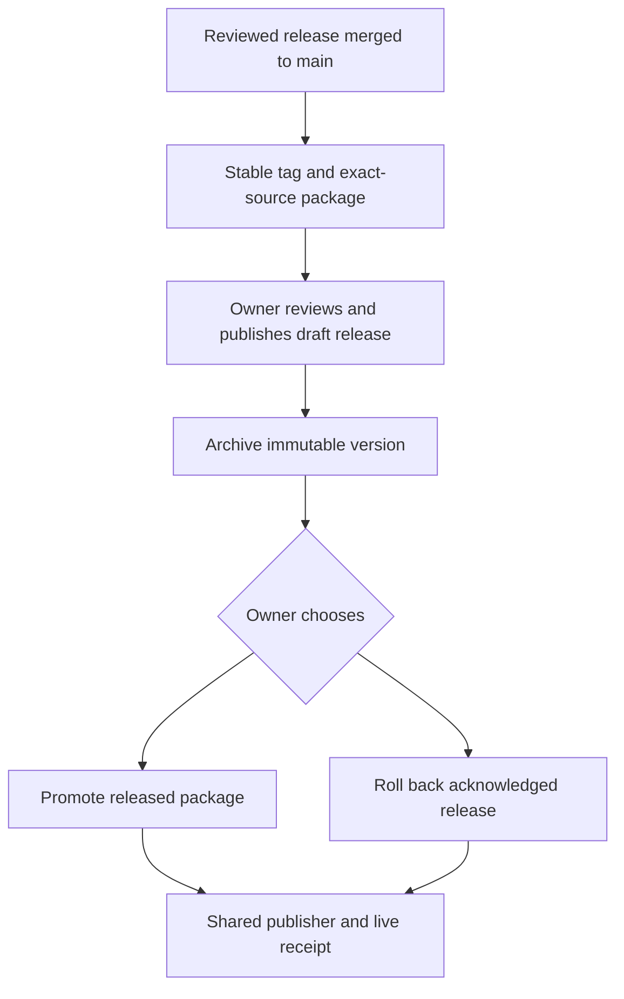

# Versioned release packaging, promotion and rollback

This guide describes the #32 implementation. It takes effect after reviewed staging integration and promotion of the workflow/tooling to **main**. Repository Wiki and milestones remain the planning authority. Existing v2.1.0 tags/assets are preserved; this change creates no release or tag.

## What changes

Ordinary reviewed main merges still publish production through the existing Candidate validation and Browser E2E process. A stable tag starts a separate packaging workflow. Packaging prepares a **draft GitHub Release** with two builds from that exact tag; it does not deploy production. After reviewing/publishing that GitHub Release, an operator explicitly archives or promotes it through **Publish website**, using the same serialized publisher as all other channels.

| Operation                         | Inputs in Publish website                                                                                | Result                                                                             |
| --------------------------------- | -------------------------------------------------------------------------------------------------------- | ---------------------------------------------------------------------------------- |
| Archive a released version        | branch `main`, operation `archive-release`, release_tag `vX.Y.Z`                                         | Adds `/papertrail-reader/releases/vX.Y.Z/`; production remains unchanged           |
| Promote a released version        | branch `main`, operation `promote-release`, release_tag `vX.Y.Z`                                         | Retains the immutable URL and installs the package's production build at the root  |
| Roll back a released version      | branch `main`, operation `rollback-release`, release_tag of a previously acknowledged production release | Restores that exact production build and retains every version URL                 |
| Recover interrupted publication   | operation `reconcile`                                                                                    | Republishes saved desired state, verifies live assets and acknowledges the receipt |
| Existing channel archive rollback | operation `rollback`, branch `main` or `staging`, archive_id                                             | Existing tree/run recovery behavior; distinct from SemVer releases                 |

Select workflow ref **main** for release operations. Environment approvals, if configured, still apply to the shared publisher. The `github-pages` environment must allow main/staging workflow branches; packaging tags do not directly deploy Pages.

## Before tagging

1. Finish feature work on staging. Promote through a reviewed `release/X.Y.Z` PR to main with required Candidate validation and Browser E2E. Keep merge commits available and synchronize release fixes back to staging.
2. Update `package.json.version`, both lockfile version fields and the changelog in the reviewed release commit. Add `docs/releases/vX.Y.Z-notes.md` (or `docs/releases/vX.Y.Z.md`) describing changes and validation.
3. Verify production identity and receipt for that main merge. Create stable tag `vX.Y.Z` at the reviewed commit. Pre-release tags, leading-zero versions and tags outside main ancestry are rejected.
4. The tagged source must include the versioned storage-isolation implementation. Historical v2.1.0 is not repackaged or retagged by this workflow. The first live rehearsal needs a future owner-approved release containing this tooling.

## Package workflow

`Package versioned release` runs for pushed `v*` tags; it can be retried manually on main with an existing `release_tag`. Trusted packaging scripts are read from main before checking out the exact tag. Tag/package/lock versions, source ancestry, commit and tree identities, base paths and release notes are checked.

The build job has read-only repository permissions and does not persist checkout credentials. It installs the tagged lockfile without install scripts, then builds two distinct base paths:

- `versioned`: `/papertrail-reader/releases/vX.Y.Z/`, channel `release`.
- `production`: `/papertrail-reader/`, channel `production`.

These builds come from the same tagged source but use different asset paths. Their individual `build.json` manifests include exact source SHA/tree/run/version/base path and SHA-256 for every payload file. `papertrail-vX.Y.Z.json` contains both regular-file payloads in canonical Base64 plus identity metadata; its companion `.sha256` verifies the whole package. Extraction rejects unsafe paths, reserved deployment names, invalid encodings, mismatched source/base identities and changed or missing files. No tar links or executable unpack scripts are accepted.

A separate write-permission job attaches these two assets to a draft GitHub Release. It never replaces different existing bytes, never modifies an already published release, and does not publish the draft. A rerun with identical bytes is allowed; a collision requires investigation, not deletion of published assets.

## Review and explicit publication

Review the draft's notes, exact tag/source SHA, workflow result and downloadable package/checksum. Publishing that GitHub Release only makes the assets available for explicit publisher operations. It does not overwrite production.

Run `archive-release` first to validate the immutable page. The publisher reads assets from the repository's **published stable** release, resolves the tag, confirms main ancestry, validates the package, and rechecks tag/release/main freshness before altering saved deployment state. It preserves production, staging, active previews, retired preview pages and recovery archives. An existing version path with different package bytes is rejected.

After archive publication, open the reported version URL and verify reader startup, assets, version/SHA identity and isolated saved data. Version URLs use a per-version IndexedDB namespace; they do not import production, staging or preview reading metadata. Theme preferences remain shared as before. Root promotion retains the production database names, preserving users' existing reading data.

`promote-release` installs the already built production payload without rebuilding. `rollback-release` additionally requires evidence that this exact release package was previously acknowledged in production history. Neither operation moves Git tags or changes main's source history.

Explicit promotion/rollback records a production hold against the current main SHA. Saved-state reconciliation and retries preserve it. A later reviewed main merge advances that SHA and resumes normal automatic production deployment; it clears the hold. A reconcile operation by itself is not a request to restore current main.

## Live verification and failures

All operations share `pages-publisher` serialization. Saved desired state is pushed to `pages-state`, the full aggregate is deployed, live build identity and critical index/JS/CSS hashes are verified for production, staging and every immutable release, and only then is a successful receipt/history written. Active preview identities and retired preview pages are also verified.

- Failure before desired-state persistence: no new accepted publication; correct inputs/package/checks and retry.
- Failure after state persistence or during live verification: no successful receipt is claimed. Run `reconcile` to publish the saved aggregate, then confirm identity/assets and receipt.
- Main/tag changes while queued: the freshness check rejects the operation. Re-select and review the intended current boundary before retrying.
- Immutable path/package collision: stop and investigate source/run/checksum identity. Do not overwrite an existing released version to make a retry pass.
- Missing/expired workflow artifact: published GitHub Release assets remain the release source; artifacts are not the sole long-term copy.
- Retired or draft PRs: existing preview retirement/notice handling continues within the aggregate. Release operations do not reopen previews or bypass required PR checks.

## Retention and acceptance

Package-workflow artifacts are requested for **90 days**, subject to repository/organization retention limits. Candidate/browser evidence keeps the existing documented retention (at least 30 days). Published GitHub Release assets and immutable version URLs have **no automatic pruning**; deletion is an explicit owner maintenance action. Deployment recovery archives retain their existing policy. Check repository settings before relying on a configured retention duration.

Local automated rehearsal covers archive → promote → acknowledged history → second release → rollback, channel preservation, immutable collisions, checksums, rejected versions/paths/source identities and production storage compatibility. It is separate from live acceptance.

Before closing #32, record a real future release's tag SHA, package run and SHA-256, immutable URL/live verification, explicit production promotion, previously acknowledged version rollback, successful receipt, preservation of other channels and owner acceptance. PR merges/activation and those release operations are intentionally not reported as completed by implementation tests.

