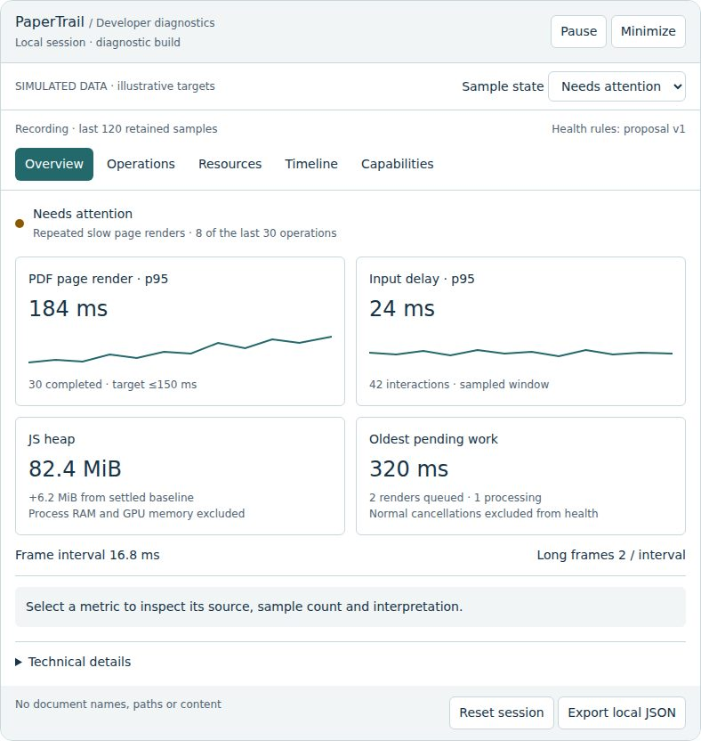
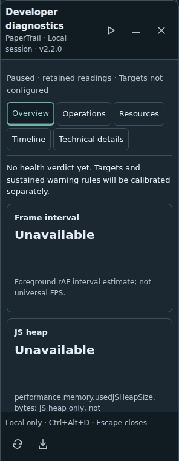

# Developer diagnostics dashboard plan

Parent [#167](https://github.com/HimanshuHD/papertrail-reader/issues/167). Requested 21 October 2026 after the opt-in sampler in PR #248. This records the previous discussion and the expanded prototype; it is a design proposal, not measured evidence.

The editable [prototype](dashboard-prototype.html) is a self-contained HTML fragment. Its numbers, thresholds, charts and health states are explicitly simulated. It is not an app screenshot. Use the sample-state selector, section tabs and metric cards to inspect states and explanations. Pause/minimize, baseline and JSON buttons demonstrate local interactions.

## Previous discussion and purpose

The user asked how to read the raw diagnostic sampler, which data is useful, a clearer UI, and green/yellow/red performance indicators. They requested planning before development, a sample prototype, and additional browser performance/memory attributes. The agreed direction is an understandable diagnostic aid, not a synthetic benchmark score or a universal memory limit.

The initial proposal grouped Overview (recording, status and findings), Responsiveness, Reader operations, Library, Resources/memory, event timeline and collapsed Technical details. Controls include start/pause/resume/reset, minimize, workload/operation filters, a comparison baseline and private local JSON export. Reader operation rows use last, median, p95, worst and count; explain units, source, sample scope and limits beside the data. The sample prototype offered Good/Needs attention/Critical/Limited support, section tabs and clickable explanations. Initial implementation groups responsiveness into Overview and library/reader timings into Operations; the expanded proposal retains those concepts without consuming more reader space.

## Delivery order

1. **#249 Dashboard/read model** — first implementation in existing open PR #248. Four readable sections, actual readings/trends, operation statistics, honest resource labels, outcome timeline, accessible controls and collapsed raw evidence. No proposed-only readings or fabricated health scores in the app.
2. **#250 Indicators** — operation-specific, calibrated, versioned targets; sustained findings, recovery/hysteresis, reasons and neutral collecting/unsupported/paused states.
3. **#251 Responsiveness/loading** — input/interaction timing, long animation frames and forced-layout attribution, resource/startup timing where relevant.
4. **#252 Resources/investigation** — request queues, cache occupancy/hit/miss/eviction, storage latency, pending age, release delay, memory baselines and tracked cleanup ownership.
5. **#253 Acceptance** — representative workloads, total instrumentation/UI overhead, accessibility, cross-browser support and exact-source owner/staging evidence.

All are linked from #167. **#16 owns external CPU/GPU/process-memory profiling and accepted performance budgets.** No automatic workflow or Visual QA changes are needed. Owner merges PRs; progress stays in issue/PR bodies, avoiding multiple comments.

## Detailed additional metric inventory

| Area                     | Proposed readings                                                                                         | Meaning and limitations                                                                                                                        |
| ------------------------ | --------------------------------------------------------------------------------------------------------- | ---------------------------------------------------------------------------------------------------------------------------------------------- |
| Interaction              | input wait, handler processing, interaction latency                                                       | Event Timing where supported; group interactions correctly; sampled windows are not automatically official INP                                 |
| Responsiveness           | foreground frame interval, long-task durations, long animation frames, blocking/render/layout attribution | Distinguish Long Tasks and LoAF to avoid double counting; background gaps are not user-visible stalls; no FPS-to-CPU inference                 |
| Reader operations        | PDF/EPUB open-readable, render/navigation/chapter/reflow; cold open, restore and warm activation          | Different work needs different targets; last/median/p95/worst/count; withhold p95 until sufficient completed samples                           |
| Library                  | first listing and completed scan, eventually 100/1,000-file workloads                                     | User-selected local file operations are not network Resource Timing                                                                            |
| Worker queues            | queue wait, processing, response, pending count/oldest age, cancellation                                  | Instrument actual ownership; shared/fake workers and PDF task owners are not OS thread totals                                                  |
| Loading                  | resource request timing, transfer/cache hints; optional navigation/paint/LCP/layout shift                 | Cross-origin/cache metadata limitations; network assets only; omit URLs; startup metrics do not rate runtime reading                           |
| Persistence              | IndexedDB read/write/restore durations, pending age and failures                                          | Aggregate fixed operation categories; omit keys, paths and document IDs                                                                        |
| Cache                    | hits/misses, occupancy, eviction, warm/cold distinction                                                   | Application-owned entries only; no exported content or cache keys                                                                              |
| Memory                   | JS heap trend and marked/settled baseline; optional user-agent page memory                                | Heap excludes much native/GPU memory; optional API requires secure/isolation/support conditions; no hosting-header changes merely to enable it |
| Graphics and blobs       | owned canvas/preview pixel estimates, owned Blob bytes/URLs                                               | Label estimates; avoid double counting; never present them as physical GPU or total process memory                                             |
| Cleanup                  | mounted readers, PDF worker owners, owned listeners/observers/timers, release delays, baseline comparison | Track only instrumented owners. Expected five-minute inactive-reader retention/cache warming is not a leak verdict                             |
| Storage                  | origin usage/quota estimate                                                                               | Disk estimate, not RAM or per-document exact usage                                                                                             |
| External profiling (#16) | process/main/worker CPU, renderer/browser/worker RAM, GPU process/allocation evidence where exposed       | Use DevTools/OS tooling; source/method/workload/repetition required. Unavailable stays unavailable                                             |

Anonymous Reader A/B attribution is allowed only when real recording ownership supports it; never invent attribution from aggregate records. Filters must describe their actual retained dataset. No fixed rolling time-window claim is valid without timestamps.

## Indicator rules

Good (green), Needs attention (yellow), Critical (red), and Unavailable/Collecting (gray) need text/icons, explanations and accessible alternatives. Do not invent a composite score. Rules consider operation/workload, sample minimum, recency, repetition, lifecycle and browser support. Configure units, window, repeated/sustained breaches, recovery and rule version/source; export the active settings. Until #16 establishes budgets, targets remain unconfigured or clearly provisional. A single expected cancellation, normal cache growth, background frame gap or retained inactive reader must not cause a critical alert. Memory growth is a prompt to investigate cleanup/retaining paths, not proof of a leak.

## Privacy, lifecycle and build boundary

Development or explicit diagnostic builds only. Default production/hosted previews exclude panel, recorder and diagnostic strings; query flags cannot enable them. Local bounded collection/export only; no titles, paths, text, annotation data, DOM selectors, raw URLs, binary documents or unreviewed attribution strings. Unsupported readings use null/reasons, not fake zeros. Pause/close/reset/unmount release observers, timers, pending work and keyboard handlers appropriately. Minimize may continue sampling without obscuring reader controls; expand/close restores sensible focus.

## Acceptance plan

Use identical representative PDF/EPUB/library scenarios and compare production, diagnostics closed, minimized sampling and paused. Measure full diagnostic/UI overhead, not just the synchronous sampling callback. Cover 100/1,000 files, text/image/1,001-page PDFs, CSS/image and long-chapter EPUB, cold/repeat, restore, rapid cancellation, scroll/zoom/reflow, five-minute retention expiry and repeated teardown. Check light/dark, 320px/desktop, keyboard/accessible alternatives and Chrome/Firefox/WebKit capability fallbacks. Native browser/OS targets and owner preview/merge/staging acceptance remain explicit; manual Visual QA remains manual. Retain exact source/tree/flags and safe aggregates. Existing #248 CI/initial small-fixture measurements are historical evidence for their exact source, not proof for this UI revision or universal budgets.

## Implemented panel chrome update

Owner follow-up: move Pause/Resume, Minimize and Close to an icon-only header; Reset/Export to an icon-only footer; Technical details to the final tab. Use one shared custom tooltip per focused/hovered action, without native titles. Header/footer stay outside the scrolling content.

The bottom-edge minimized launcher has top rounding only and no bottom border. Its 24px, four-ring pulse adapts the owner-supplied `loader.html` (2.4s period, 0.6s offsets, bounded scale 3.2 around a 7px core). Closed/paused is gray and static; reduced motion disables animation. Recording defaults green; three sustained foreground responsiveness samples can produce yellow/red using explicitly provisional rules documented in the developer guide and JSON export. This does not complete #250's calibrated workload indicators.

Local browser captures of this implementation (not simulated prototype values):

