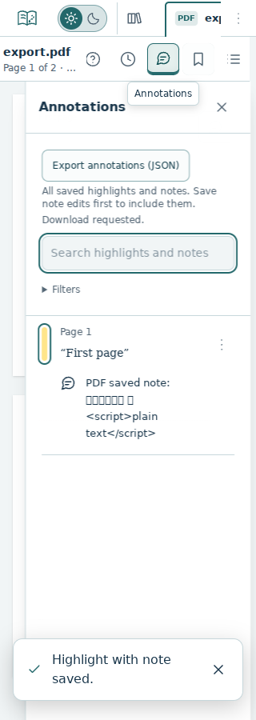
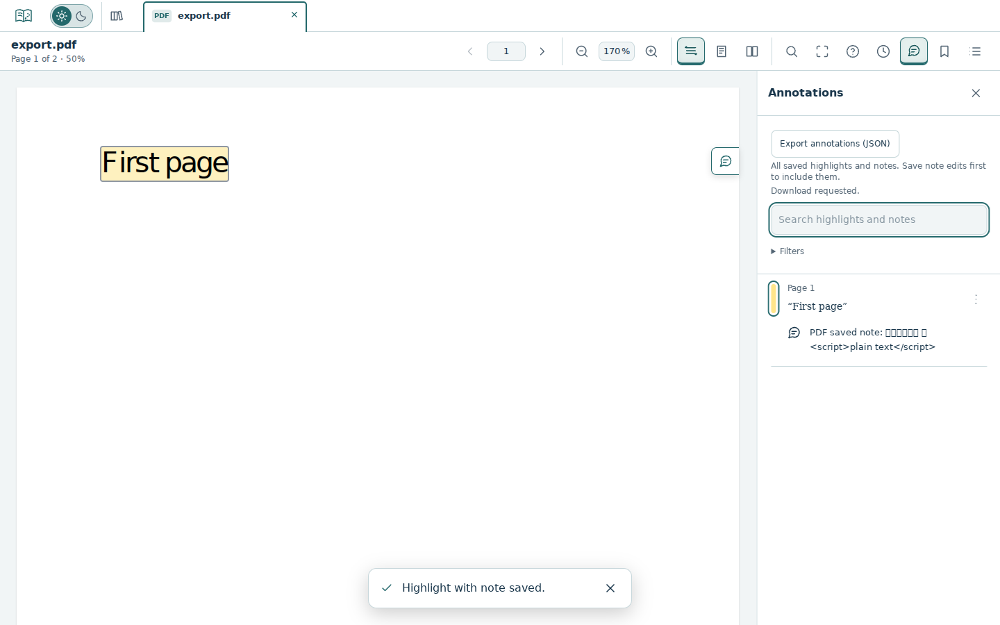
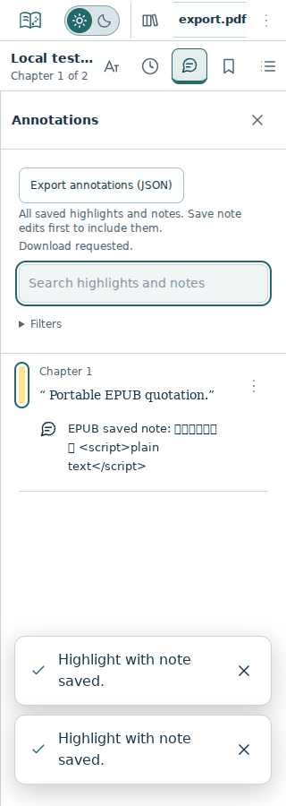
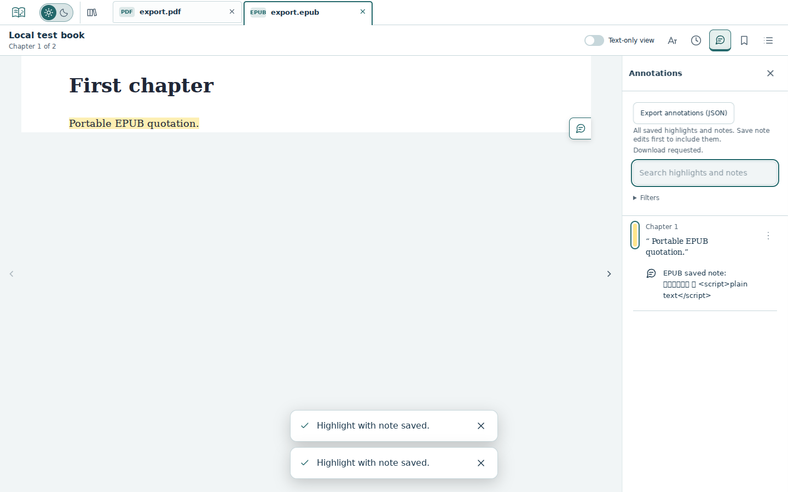

# Annotation export acceptance (#239)

Base: accepted #238 staging `01f0aedcb069e10797b34fb5db7b81aa79f90bd0` (tree `34bba16bcbc7678de5eacd5645ee4f7d11c861ae`). Implementation branch: `feature/239-annotation-export`; the PR records its exact final source/tree and required CI. These checks validate a candidate, not accepted staging delivery or a production release.

## Local validation — 20 October 2026

- Lint, formatting, types, **94 pipeline and 389 unit/component tests**, production build and diff checks passed. Eight added unit/component cases cover exact PDF/EPUB serialization, unknown-field removal/nonmutation, empty/bounded/invalid/future data, filenames, URL/anchor cleanup, filtered panels, unsaved drafts, disabled states and actionable failure feedback.
- Final real-browser matrix: **20 passed, zero failed/skipped/flaky**, 211.4s, 320/375/768/1024/1440px × 900px. Each width exercises new mixed-format JSON downloads, existing document-tab annotation ownership, PDF highlight/note persistence and EPUB highlight/note persistence across view changes/reload/local edits.
- Download contents preserve verified format/fingerprint, exact selectors, Unicode/plain-text notes and stable annotation IDs/timestamps. Keyboard Enter triggers repeated downloads. Filters do not truncate exports; switching back retains the original document's annotations and page. No writes or migrations are introduced by export.
- Four original export-panel captures below were inspected. Local runtime fonts lack some Devanagari/emoji glyphs; downloaded Unicode content is asserted exactly, without replacing characters.

Runtime: temporary headless Chromium **153.0.8010.0**, Playwright 1.63.0, Linux container, production build served at localhost. Normal Playwright browser download failed because its downloaded archive was truncated. A serverless Chromium package was unpacked outside the repository, with no project dependency/lockfile changes. Its single-process mode cannot reuse a second browser context: an earlier matrix had 10 passes and 10 setup failures (`browserContext.newPage: Target page, context or browser has been closed`, before app assertions). An earlier parallel attempt did not produce a complete report. Both are excluded from final acceptance. The final matrix uses a fresh browser per case through an external local config; all case bodies/assertions remain unchanged, no retries or tolerances added. A first external-config launch also failed before tests because its preview-server working directory was unset; correcting only that external cwd allowed the final run.

The final source additionally makes visible and accessible export labels identical. No workflows, dependencies, storage schemas, reader layout or approved visual baselines change. Visual comparison remains manual-only under #230. Local execution does not claim Firefox/WebKit/native-device export acceptance; existing standard integration remains required after owner merge.

## Review captures

## Owner preview

1. Open a PDF; save highlights and a note. In Annotations, activate **Export annotations (JSON)** with click or keyboard. Inspect the downloaded JSON and its document identity/selectors/note text.
2. Apply a filter hiding entries and export again: all saved entries remain included. Edit a note without saving, then export: the prior saved note is included and the draft is untouched.
3. Repeat with EPUB, switch between tabs, and export again. Each file contains only its own annotations; page/chapter and saved annotations remain intact. Empty documents may export an empty collection. Loading/unavailable/saving states disable export.
4. Cancelling a browser save dialog does not delete or change annotations. This is export only; import and comparison are separate scope. #240 follows after #239 is accepted.
