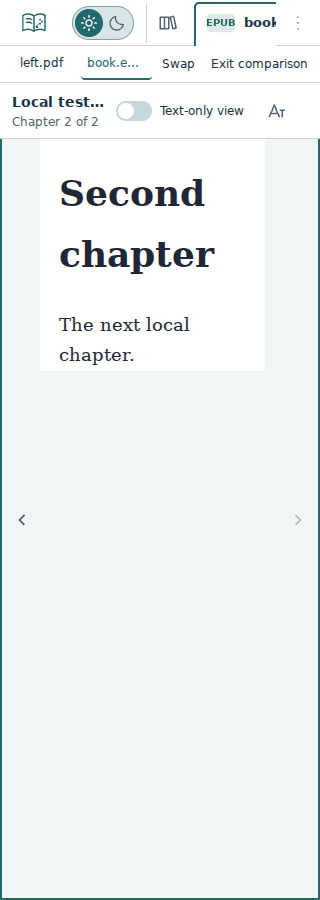
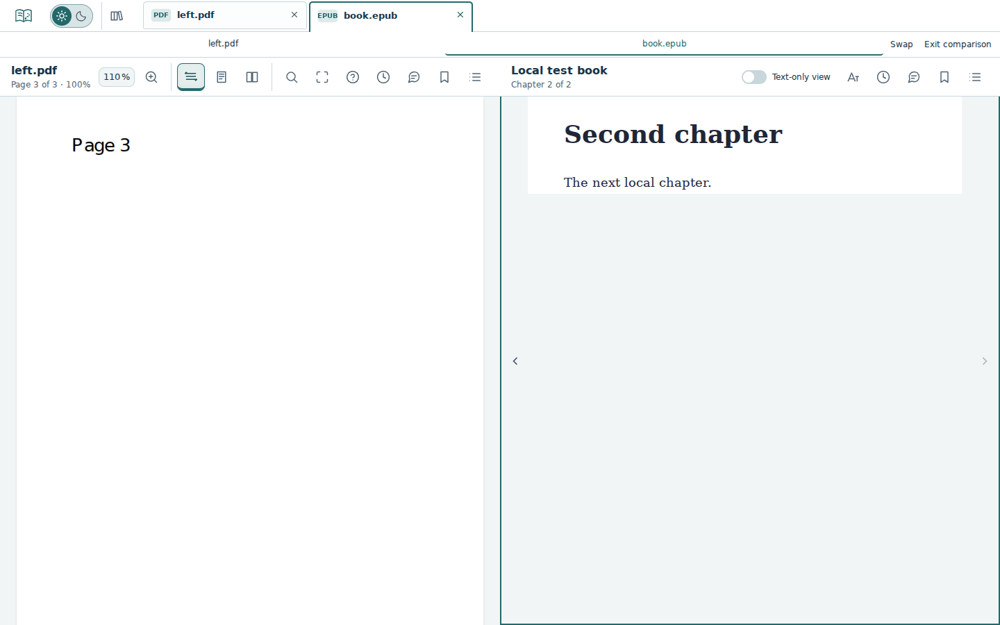
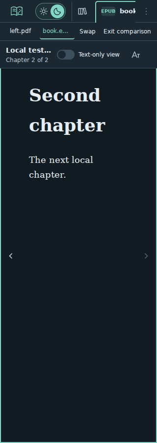
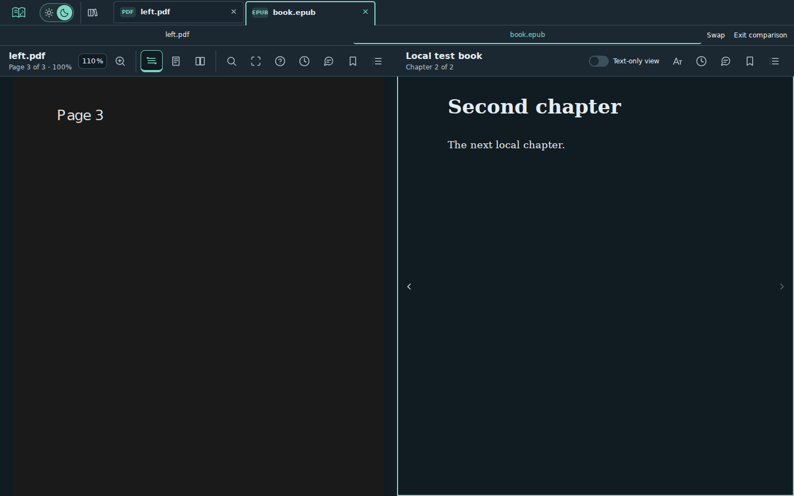

# Comparison acceptance (#240)

Base: accepted #242 staging `333a2c5f9f97bbef0f4ff846c994d2c7ec9c243f`, tree `7fa661de366a6008307afd4fa553d78f9e38c5fa`. Branch `feature/240-document-comparison`; the PR records exact final source/tree and required CI. This is candidate evidence, not owner preview acceptance, accepted comparison staging delivery, or production activation.

## Verified locally — 20 October 2026

- Lint, formatting, types, **94 pipeline + 398 unit/component tests**, production build and diff checks passed. The later supported-engine test extension was separately formatted/linted and browser-verified; application code remained unchanged.
- Final comparison/regression matrix: **45 passed, zero failed/skipped/flaky**, **357.0s**. Five widths **320/375/768/1024/1440px** at height 900: mixed comparison; same-format PDF/PDF and EPUB/EPUB; keyboard and iframe focus; independent active-reading time; per-document notes and partial reconnection; swap/exit/reload; responsive fallback; visible retention/hidden expiry; corrupt/closed/final-tab cleanup. Existing retention, restored tabs, sidebar layout and JSON downloads also pass at every width.
- Expanded existing supported-browser scenario: **2 passed, zero failed/skipped/flaky**, **27.2s**, at 375/1440px in local Chromium. Adds comparison, independent PDF page/EPUB mode, iframe focus and exit to the existing reselection/reload flow. Firefox/WebKit execution remains in the existing post-merge standard pipeline; no local Firefox/WebKit or installed-device pass is claimed.
- Visible wide panes preserve reader nodes beyond five minutes. Narrow layout releases the hidden partner after the existing five-inactive-minute deadline, then reconstructs only that reader. Unit tests verify generations, stale updates, focus ownership, rejection of unavailable/same-document choices, third-tab replacement, close fallback, transient reload state and timer cleanup. These are functional lifecycle observations, not process-memory budgets (#16/#167).
- Four original light/dark narrow/wide captures below were inspected. Dark/reduced-motion and light/normal-motion cases exercise the same compact shell and pane-local drawers. Layout thresholds use available workspace width, not screen width.

Runtime: temporary headless Chromium **153.0.8010.0**, Playwright 1.63.0, Linux container, production Vite build served locally. Runtime unpacked outside the repository because the normal Playwright archive download was unavailable/truncated in this environment. Its single-process mode uses one fresh browser per case through external local configs; no project config, workflow, dependency or lockfile changes. This is separate from the standard GitHub native/engine gate.

## Earlier outcomes and corrections

The first six-case local probe had **2 passed, 4 failed**. Two bounds assertions measured a drawer during its entering transition; they now use the existing layout-settling helper, preserving the bounds requirement. Two same-format cases supplied an unsupported fixture option and therefore generated identical EPUB bytes; verified deduplication correctly reused one tab. The fixture now contains distinct chapter content. The corrected eight-case probe and separate two-case notes/reconnection probe passed. The final 45-case matrix and two-case supported scenario above are authoritative; no retries, larger tolerances or forced clicks were added.

#242's accepted integration **39427836804** had **416 passed, one flaky sidebar-layout case passing on retry, 12 intentional skips**. That case measured the sidebar during close/reopen transitions. This PR synchronizes both geometry observations with the existing `settleReaderLayout` helper. All five final local sidebar-layout cases pass with zero retries. No unrelated flaky result is hidden or presented as a zero-flake #242 run.

## Preview checklist

1. Open two different PDFs/EPUBs. Use **Compare documents** beside tabs, then select a partner. Check two columns with at least 960px of reader space, or explicit Show controls below that.
2. Focus/click either pane, including EPUB text. Only its selected tab, shortcuts and reading time should be active. Verify independent page/chapter/settings, annotations, and utility drawers. Swap keeps state and reader instances.
3. Resize/collapse/reopen the library; the comparison should adapt without losing state. Select a third tab to replace the focused slot. Exit keeps the focused document. Close either compared tab and verify the surviving document remains usable.
4. Reselect a source missing one document, then restore it. Matching content reconnects; the other pane and its notes remain usable. Close the final tab without a reload and open a fresh file.
5. Reload intentionally returns to normal single-reader tab restoration; comparison arrangement is transient. Production remains v2.1.1. Manual visual comparison and baseline adoption remain separate under #230.

## Captures

